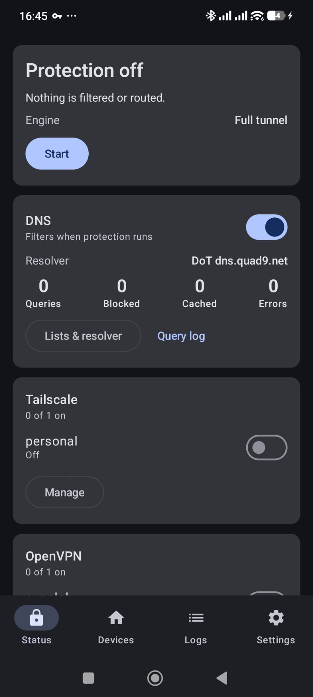
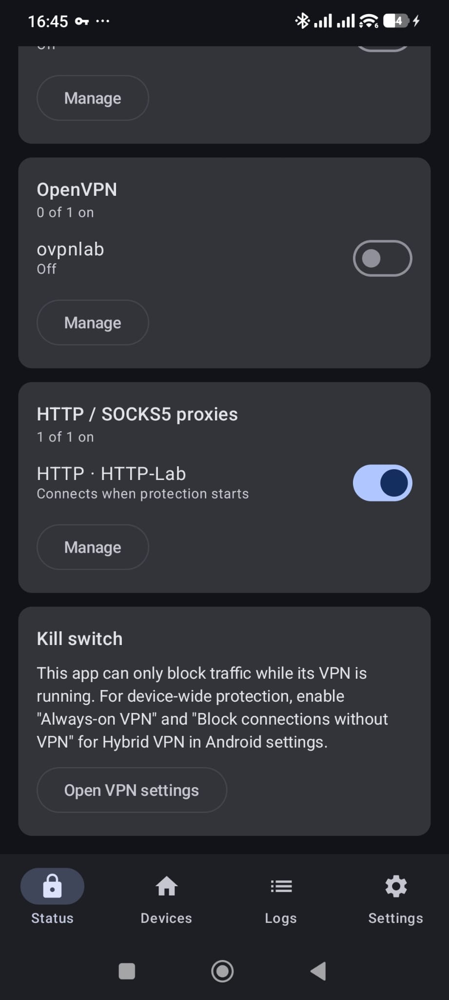

# Hybrid VPN — Android Network Control Center

A local-first, non-root Android app that will unify DNS filtering, proxying, Tailscale and OpenVPN
behind one `VpnService` and one policy engine, plus a persistent LAN device inventory.

> **Status: experimental hobby project.** Version 0.6. The full-tunnel Go engine is the default; it
> runs the DNS firewall, policy routing, Tailscale and OpenVPN, each switchable on the Status page.
> A DNS-only engine is the fallback. Expect rough edges, and don't rely on it where a VPN failure
> could hurt you. See [docs/ARCHITECTURE.md](docs/ARCHITECTURE.md) for the
> state of each milestone.

Non-profit and open source: no ads, no account, no analytics, no backend.

What works today:

- **DNS firewall.** A `VpnService` that captures only DNS. It filters queries with AdGuard-style,
  hosts-file and plain-domain lists and with per-app JSON policy rules, resolves over UDP, DoT or
  DoH via protected sockets, caches, and logs per app (counters only, memory, or persistent with retention).
- **LAN scanner.** mDNS, SSDP/UPnP, ICMP/TCP probing, reverse DNS and ARP where Android allows it.
  Devices get evidence-based persistent identities, user names, notes, groups and history, with
  JSON/CSV export and new-device notifications.
- **No account, backend, telemetry or TLS interception.**

With the full-tunnel Go engine (the default, [ADR 0007](docs/adr/0007-go-forwarding-engine.md)):

- **Full-tunnel policy routing**: per app, CIDR, protocol and port, with fail-closed transports.
- **Optional IPv4/IPv6 ping** through direct, Tailscale and OpenVPN routes (Settings → Network
  compatibility; off by default). Echo reachability only; arbitrary ICMP and traceroute remain unsupported.
- **Optional LAN discovery & connections**: connected LAN subnets, broadcast and multicast can
  bypass the VPN for local apps such as KDE Connect. Off by default; bypassed traffic is outside
  routing/filtering rules ([ADR 0010](docs/adr/0010-optional-lan-bypass.md)).
- **Several Tailscale tailnets at once**, each a separate identity with its own MagicDNS
  ([ADR 0006](docs/adr/0006-multiple-tailnets.md)).
- **OpenVPN profiles** via OpenVPN 3 Core, used only where a policy rule sends traffic
  ([ADR 0008](docs/adr/0008-openvpn3-core.md)).
- **HTTP proxies** compatible with mitmproxy’s default regular mode (port 8080), using TCP
  CONNECT and optional Basic authentication ([ADR 0011](docs/adr/0011-http-connect-proxies.md)).
- **SOCKS5 proxies** (TCP via CONNECT, UDP via UDP ASSOCIATE, optional username/password) for all
  traffic or chosen apps, failing closed when the proxy is down
  ([ADR 0009](docs/adr/0009-socks5-proxies.md)).

Not yet: OpenVPN-pushed DNS, encrypted backup (M3, M5, M6).

## Screenshots

<p>
  
  
</p>

## Layout

| Path | What |
| --- | --- |
| `app/` | Android app: Compose UI, `VpnService`, Room persistence, Android-specific scanner glue |
| `engine/` | Pure-Kotlin/JVM core: IP/UDP/TCP codecs, DNS codec, filter lists, cache, upstreams, DNS proxy, policy engine |
| `discovery/` | Pure-Kotlin/JVM LAN discovery: mDNS, SSDP, subnet sweep, ARP, classification, identity resolution |
| `app/schemas/` | Exported Room schemas (migration source of truth) |
| `schemas/` | JSON Schema for the policy document |
| `docs/` | Architecture, routing/policy reference, threat model, test plan, ADRs |

`engine` and `discovery` have no Android dependencies, so their logic is unit-tested on the host.

## Build and test

Requirements: Android Studio (bundled JDK), Android SDK platform 37.

```sh
export JAVA_HOME="/Applications/Android Studio.app/Contents/jbr/Contents/Home"   # macOS
./gradlew :engine:test :discovery:test   # host unit tests
./gradlew :app:assembleDebug             # app/build/outputs/apk/debug/app-debug.apk
./gradlew :app:lintDebug
```

Install with `adb install -r app/build/outputs/apk/debug/app-debug.apk`.

The Go engine is built automatically when an Android NDK is installed. OpenVPN
additionally needs native dependencies, which are fetched by checksum and built once (a few minutes)
into the git-ignored `third_party/`:

```sh
scripts/openvpn3-deps.sh        # OpenSSL 3.5, OpenVPN 3 Core, asio, LZ4 for Android and the host
```

See [go/README.md](go/README.md) for the Go side and its tests.

## Using it

1. **Status → Start.** Accept Android's VPN consent dialog. Nothing is blocked until a list is enabled.
   Status shows each module (DNS, Tailscale, OpenVPN, HTTP/SOCKS5 proxies) with its own switches; **Logs** shows
   DNS queries, OpenVPN session logs, failed connections and engine errors. **Routing → Routing paths**
   shows which rule sends what where, and whether each connection is up.
2. **Status → DNS → Lists & resolver.** Enable a list; it downloads then, not before. Add your own lists by HTTPS URL, or
   write rules under **My rules** (`||ads.example^`, `@@||allowed.example^`, `0.0.0.0 host.example`).
3. **Devices → Scan.** On Android 17 you will be asked for local network access. Granting location
   (optional) lets the app tell Wi-Fi networks apart by SSID.
4. For a device-wide kill switch, turn on *Always-on VPN* and *Block connections without VPN* in
   Android's VPN settings.

Known limitations:

- DoH uses Android's built-in HTTP/1.1 client, so HTTP/2-only servers (Quad9's DoH endpoint) are
  rejected with a clear error. Use Cloudflare, Google or AdGuard DoH, or Quad9 over DoT.
- If Android's **Private DNS** is set to a specific hostname, Android sends DNS there
  directly and filtering is bypassed. The status screen warns about this.

## Licence

HybridVPN is free software under the [GNU General Public License v3.0 or later](LICENSE). It bundles
third-party components under their own licences (Apache-2.0, BSD, MIT, MPL-2.0 for OpenVPN 3 Core,
BSL-1.0); see [THIRD_PARTY_NOTICES.md](THIRD_PARTY_NOTICES.md). The app shows them under Settings →
About → Open-source licences. Regenerate the notices with `python3 scripts/gen-notices.py` after
changing dependencies.

This software comes with **no warranty**. It is an independent project, not affiliated with,
endorsed or sponsored by OpenVPN Inc., Tailscale Inc., AdGuard or Google. OpenVPN, Tailscale,
AdGuard and Android are trademarks of their respective owners, used here only to name the
technologies the app works with.


## Downloads and public releases

Explicit public releases provide installable ARM64, x86_64 and universal APKs as GitHub Release
assets. The universal APK contains both supported architectures. 32-bit ARM/x86 are not currently
supported by the full engine. These experimental APKs use the project's debug signing identity;
keep that private keystore stable for compatible updates. Native dependencies and signing keys
are never included in source archives. See [docs/RELEASING.md](docs/RELEASING.md) for the private
history/public snapshot workflow.
